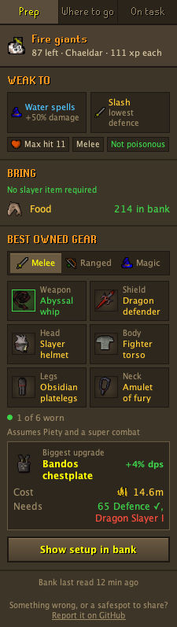
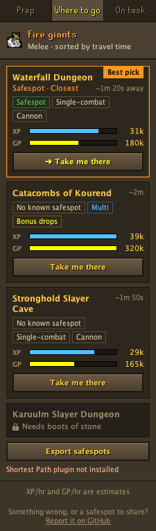
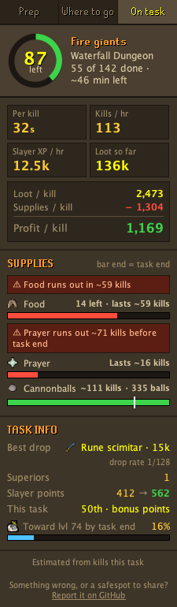

# Slayer Companion

A RuneLite plugin that helps with the whole slayer task: what to bring, where to go, and how the task is going.

| Prep | Where to go | On task |
|:---:|:---:|:---:|
|  |  |  |

- **Prep** — the task monster's weaknesses, the slayer items it needs, the best gear you own for each combat style,
  and the biggest upgrade to aim for next.
- **Where to go** — every location for the task, ranked by XP/hr, GP/hr and travel time, with safespots marked.
  "Take me there" draws the route if you have the [Shortest Path](https://github.com/Skretzo/shortest-path) plugin.
- **On task** — kills left, time left, loot picked up, supplies used and profit per kill.

## Report a problem or share safespots

I'm not an OSRS expert, so some of the game info may be off. If something looks wrong, please
[open an issue](../../issues/new/choose) and pick one of:

- **Wrong game info** — a weakness, requirement, location, drop, price or time that doesn't match the game.
- **Share safespots** — mark safespots in game (shift-right-click a tile → *Mark safespot*), press
  **Export safespots** on the *Where to go* tab, and paste the result. Shared safespots ship to everyone
  in the next update.
- **Something's broken** — errors, a stuck panel, or anything that doesn't work.

## Data and credits

Monster stats, drop tables, item bonuses and requirements, slayer locations and safespot notes come from the
[Old School RuneScape Wiki](https://oldschool.runescape.wiki), partly through the data files of Weird Gloop's
[osrs-dps-calc](https://github.com/weirdgloop/osrs-dps-calc). That data is used under
[CC BY-NC-SA 3.0](https://creativecommons.org/licenses/by-nc-sa/3.0/), and the bundled data files stay under that
licence. Damage calculations follow the formulas used by the Wiki's DPS calculator.

Old School RuneScape and its game art are the property of Jagex Ltd. This plugin is not affiliated with Jagex.

## Licence

The code is released under the BSD 2-Clause licence; see [LICENSE](LICENSE).
